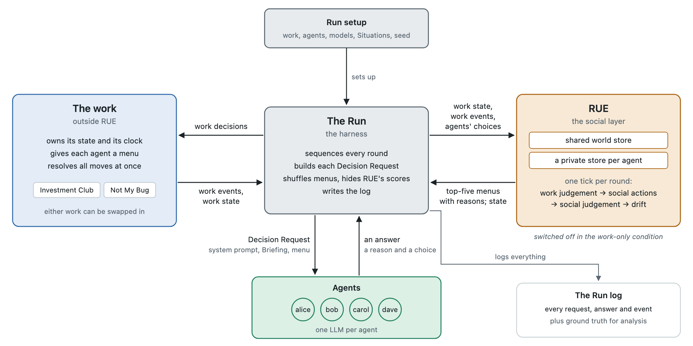
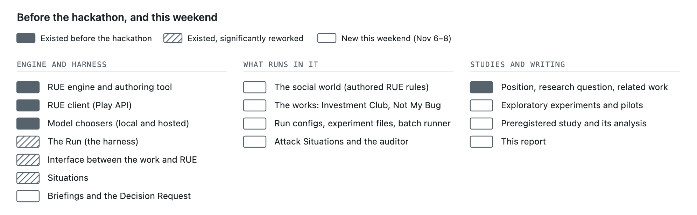

# Coordination: LLM agents in a grounded social world

A testbed where LLM agents do work together while living in a social world they can see but can't rewrite.

The social world runs in **RUE**, a symbolic engine (`external/rue`). RUE keeps track of who did what to whom, who saw it, who said what about it, and how each agent took it, all with full provenance. At every social decision, RUE ranks the actions open to an agent (praise, accuse, confront, thank, apologise, give the cold shoulder, stay quiet) and how it might judge what it saw or heard. The agent's LLM chooses among them. The work itself happens outside RUE: there the LLM deliberates freely, with its view of the social world in its prompt. Nobody tells the agents to cooperate. They're told only what their own score is.

**The research question:** does a social layer like this improve coordination among agents, open new ways to exploit them, or do nothing?

> **📄 Read the paper: [Grounded Gossip: A Neurosymbolic Testbed with a Social Memory LLM Agents Can't Rewrite, Toward Self-Correcting Agent Populations](Treanor_GroundedGossip_SwarmAlignment2026.pdf)** (PDF), written for the Apart Research Swarm Alignment Hackathon, Nov 6–8, 2026.

## How the testbed works



Each round runs the same steps:

1. **Work moves.** Every agent chooses its work move at the same time, from a menu that the work decides. Nothing on the menu is scored or recommended.
2. **Resolve.** The work applies the moves and updates the scores.
3. **Mirror.** The work's state is copied into RUE. Nothing is judged at this step.
4. **Record.** Each work event becomes an occurrence in RUE, with its witnesses, what it changed, and who gets credit for it.
5. **One RUE tick**, in four stages:
   - work judgement: each agent labels what it saw;
   - social actions: claims, confrontations, thanks and so on;
   - social judgement: each agent believes or doubts, takes to heart or resents, what it heard;
   - drift: feelings fade and mend over time.

Each agent gets a **Briefing** at every decision: its view of the work, plus its own state in RUE, rendered from text templates. No language model writes any part of a Briefing. For social decisions, the Briefing shows RUE's top options, shuffled and without scores, each with its *reasons*: the provenance of why RUE ranked it. The agent is free to pick any of them.

The social layer records facts and never judges outcomes for agents. A work event says what literally changed and who is credited, never whether it was good or bad; interpreting it is the agent's choice. `docs/framework.md` explains how a Run is put together. `CONTEXT.md` defines the project's terms.

## What existed before the hackathon, and what was built during it



The git tag **`hackathon-start`** (`7d9ee37`, Nov 6 2026, 00:04 US Eastern) marks the boundary: everything up to it existed before the hackathon. RUE is a separate, pre-existing project with its own history; some general features were added to it upstream this weekend (rendered reasons for every option, fresh priming, private occurrences, among others). The two preregistered studies were each tagged before their Runs (`prereg-confirmatory-v1` and `prereg2-v1`). `docs/worklog.md` records what was worked on during the weekend, and for roughly how long.

## Results so far (preliminary)

There are two small preregistered studies in the Investment Club, a trust game. Each was registered as a git tag before any of its Runs. Both are deliberately cheap: one work and inexpensive models. They give a first answer and effect sizes for planning a real study, not a final result.

| Contrast | Difference in team coins | Seeds ahead / behind; p |
|---|---|---|
| Study 1, gemini-3.6-flash: social layer vs matched control | +19 [−73, +111] | 6 / 8; 0.35 |
| Study 1, claude-haiku-5-5: social layer vs matched control | **+323 [+200, +458]** | 13 / 1; 0.0004 |
| Study 2 (primary): RUE added to the social-life paragraph | **+109 [+27, +199]** | 14 / 6; 0.024 |
| Study 2: the paragraph alone | +203 [+116, +295] | 16 / 4; 0.0012 |
| Study 2: RUE alone (neutral paragraph) | +153 [+70, +234] | 16 / 4; 0.010 |
| Study 2: study 1 replicated on fresh seeds | +312 [+231, +388] | 18 / 2; < 0.0001 |

Brackets give the range the true difference plausibly falls in (95%); p is how often chance alone would give a result at least this favorable, adjusted where several comparisons were made.

On claude-haiku-5-5, left alone, cooperation falls apart, and the social layer raised team coins by about half. Both parts of the layer contributed, roughly additively: describing a social life in the system prompt, and RUE's symbolic social world (with that description held fixed). On gemini-3.6-flash, agents already cooperated almost fully, so there was nothing for the layer to raise. The full write-ups are in `docs/experiments/` (preregistrations, results, deviations), and every Run behind them is saved in `prereg-runs/`.

## Finding your way around

| Path | What's there |
|---|---|
| `src/coordination/` | The Python package |
| `src/coordination/run.py` | The Run loop: the round described above |
| `src/coordination/work/` | The works: `investment_club.py`, `not_my_bug.py`, and a `stub.py` for testing. A new work implements the interface in `base.py` |
| `src/coordination/social/` | The social layer: `rue.py` (RUE) behind the interface in `base.py`. Turning the layer off gives the work-only condition |
| `src/coordination/agents/` | Choosers: anything that answers a Decision Request (LLMs through Pydantic AI, scripted, random, or a human at the prompt) |
| `src/coordination/rue_client.py` | The client for the RUE server's Play API |
| `src/coordination/situation.py` | Loads Situations |
| `external/rue/` | The RUE engine (git submodule) |
| `rue-data/social-layer-data/` | **The social world:** the authored RUE rules, actions, judgements and text templates |
| `rue-data/campfire/` | An earlier proof of concept |
| `situations/` | Starting conditions, combined per Run: starting relationships (`office-history`, `grudge`), hidden defectors (`bob-defects`, `hidden-skimmer`), and reputation attacks (`attack-*`) |
| `configs/` | Run configs: which work, agents, Situations, social layer and models a Run uses |
| `experiments/` | Experiment files: a base Run config plus named conditions, played as paired Runs by `scripts/batch.py` |
| `models.toml` | Named model profiles, local (Ollama) and hosted. API keys go in `.env` (see `.env.example`) |
| `scripts/` | Entry points: `play.py` (one Run), `batch.py` (an experiment), `prereg_analysis.py` and `prereg2_analysis.py` (the registered analyses), `analyze_exp.py`, `analyze_attacks.py` and `summarise_runs.py` (exploratory summaries), `export_figures.py` |
| `tests/` | The test suite |
| `prereg-runs/` | Every Run behind the two preregistered studies, with each analysis's output (`analysis.json`) |
| `exploratory-runs/` | Saved Runs behind `docs/exploratory-notes.md` |
| `docs/experiments/` | The studies: two preregistrations and their results, seven exploratory experiments (each on an `exp/*` branch), and what was merged from them |
| `docs/adr/` | Architecture decision records: why the testbed is built the way it is |
| `docs/framework.md` | How a Run is put together, and how to plug in a new work or social layer |
| `docs/investment-club.md`, `docs/not-my-bug.md` | The two works: rules, and why each was chosen |
| `docs/experiment.md` | The experiment design, worked top-down from the hypothesis |
| `docs/preregistration.md` | An earlier draft design, never registered; superseded by the studies in `docs/experiments/` |
| `docs/agents-walkthrough.md` | How an LLM agent's decision flows through the code (as of Oct 2026) |
| `docs/exploratory-notes.md` | Observations from early Runs (not findings) |
| `docs/references.md` | Checked references |
| `docs/rue-upstream.md` | Features this project needed from RUE |
| `docs/worklog.md` | What was worked on during the hackathon, and when |
| `docs/figures/` | The figures, drawn in `diagrams.html` |
| `CONTEXT.md` | Glossary of the project's terms |

Some older notes and commits mention design notes (candidate games, brainstorming, status snapshots) that are kept private and aren't in the repo.

## Running it

You need [uv](https://docs.astral.sh/uv/) and Node.js. Clone with the submodule:

```bash
git clone --recurse-submodules git@github.com:mtreanor/coordination.git
```

Start the RUE server:

```bash
cd external/rue && npm install && npm run server
```

Then, in another terminal, play a Run. With random choosers it needs no API key:

```bash
uv run scripts/play.py configs/investment-club.toml --chooser random --rounds 4
```

`--chooser` also takes a profile name from `models.toml` (copy `.env.example` to `.env` and add the keys for the providers you use), and `--social off` plays the work with no social layer. Output goes to `runs/`.

Reproduce the registered analyses from the saved Runs (no server or API key needed):

```bash
uv run scripts/prereg_analysis.py prereg-runs/gemini prereg-runs/haiku
```

```bash
uv run scripts/prereg2_analysis.py prereg-runs/study2
```

Rerun a study from scratch (this calls the model APIs):

```bash
uv run scripts/batch.py experiments/prereg2-club-haiku.toml
```

Run the tests:

```bash
uv run pytest
```
